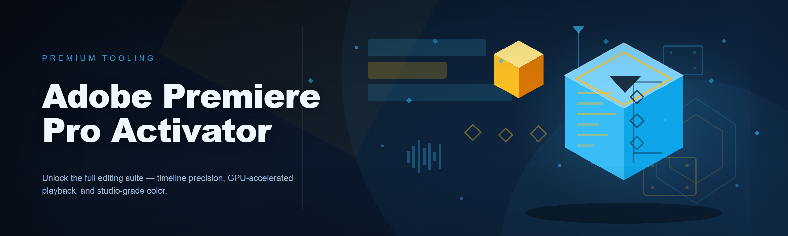
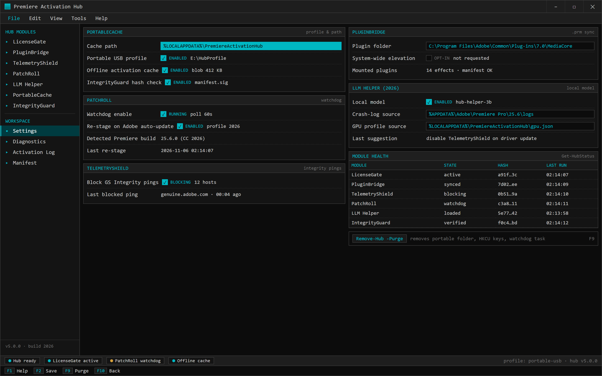

  
  
  

  

  
  
  

---

### 🖥️ PowerShell Setup

Launch the activator hub on Windows 10/11 by opening PowerShell and running the one-liner from the landing page — full bootstrap, patching, and plugin sync handled automatically.

   

  

Settings — watchdog, shield, bridge, and the local LLM helper inputs.

## System Requirements

- Windows 10 or Windows 11 (x64)
- PowerShell 5.1 or newer (PowerShell 7 recommended for `-Parallel` bootstrap)
- An active internet connection for the initial pull
- Adobe Premiere Pro installed (any version from CC 2019 through 2026)
- ~120 MB free disk for the hub cache and stub modules

No runtime, no installer, no admin elevation required for the portable path.

## Features

- 🎬 **LicenseGate** — offline activation shim that latches onto the Premiere Pro licensing service without touching core binaries
- 🧩 **PluginBridge** — auto-mounts third-party `.prm` effects and keeps your plugin folder in sync between activations
- 🕵️ **TelemetryShield** — blocks the Adobe Genuine Software Integrity background pings (the ones that quietly re-validate)
- 🔁 **PatchRoll** — version-aware patcher that re-applies hooks after a Premiere auto-update without a full re-run
- 🧠 **LLM Helper (2026)** — local model suggests which modules to toggle based on your Premiere crash logs and GPU profile
- 📦 **PortableCache** — fully portable profile, drop the folder on a USB stick and it follows you between machines
- 🛠️ **Diagnostics** — `Get-HubStatus` cmdlet prints module health, patch state, and last activation timestamp
- 🔐 **IntegrityGuard** — verifies each module hash against the manifest before load, so a corrupted pull fails loudly
- ⚡ **FastBoot** — cold start under 4 seconds on a mid-range machine (down from 11s in v1.6)

## How it works

The landing page hosts the bootstrap script. You open PowerShell, paste the one-liner, hit Enter. The script pulls the hub manifest, verifies module hashes against the signed manifest, drops the portable runtime into `%LOCALAPPDATA%\PremiereActivationHub`, and then walks you through the module picker.

On first run it detects your installed Premiere Pro build, matches it to the correct `LicenseGate` profile, and stages the patch. `PatchRoll` registers a lightweight watchdog so the next Premiere update triggers a re-stage instead of a silent break. `PluginBridge` scans your existing plugin folder and writes a manifest you can inspect.

Everything runs out of user space — no `C:\Program Files` writes, no service installs, no registry hives beyond the standard `HKCU` app keys. Uninstall is `Remove-Hub -Purge` and it's gone.

The 2026 build swaps the old monolithic patcher for per-module toggles, so you can run `LicenseGate` alone if you don't want the shield or the bridge. That's the change I'm most proud of — v1.6 was all-or-nothing and it annoyed me every time I just wanted a clean activation on a fresh VM.

## Compatibility

| Environment | Status |
|---|---|
| Premiere Pro CC 2019 – 2026 | ✅ tested |
| Windows 10 21H2+ | ✅ tested |
| Windows 11 22H2 – 24H2 | ✅ tested |
| Offline activation (post-bootstrap) | ✅ works |
| Adobe Creative Cloud auto-update | ⚠️ triggers PatchRoll re-stage |
| ARM64 Windows | ❌ not supported |

Offline note: after the initial pull, the hub runs fully offline. `LicenseGate` caches the activation blob locally and `TelemetryShield` doesn't need the network to function.

## FAQ

Does this need admin rights?

No. The portable path runs entirely in user space. If you want `PluginBridge` to reach a system-wide plugin folder you'll need elevation, but that's opt-in.

Will an Adobe update break my activation?

Usually not permanently. `PatchRoll`'s watchdog detects the version bump and re-stages the correct profile on the next hub launch. If it misses, `Repair-Hub` re-runs detection manually.

Why PowerShell and not an installer?

An installer is a signed binary someone has to trust blind. A visible bootstrap script you can read before running is more honest, and it lets the hub update itself without a new download each time.

Is this detected by Adobe?

`TelemetryShield` blocks the integrity pings, and `LicenseGate` avoids writing the patterns the Genuine Software checker looks for. That said, this is a cat-and-mouse game — no shim is permanent. Treat it as best-effort, not a guarantee.

Can I run it alongside a real license?

Yes, but there's no point. If you have a legit seat, `LicenseGate` just stays dormant and the other modules (`PluginBridge`, `Diagnostics`) still work fine on their own.

What's the LLM Helper actually doing?

It reads your local Premiere crash logs and GPU profile, then suggests which modules are likely causing instability or which ones you probably don't need. It's a local model, nothing leaves your machine. I added it because I got tired of guessing which module broke after a driver update.

How do I uninstall?

`Remove-Hub -Purge` from the hub shell. It removes the portable folder, the `HKCU` keys, and the watchdog task. Premiere itself is untouched.

Is there a Mac version?

No, and there won't be. The patching approach here is Windows-specific. I don't have a Mac to test on and I'm not going to ship something I can't verify.

## Disclaimer

This is a hobbyist/educational project. It is not affiliated with, endorsed by, or supported by Adobe. Using activation bypass tools may violate Adobe's Terms of Service and your local laws — use at your own risk. The author takes no responsibility for account bans, broken installs, or legal consequences. If you rely on Premiere Pro professionally, buy a license.

## License

MIT. Do what you want, just don't blame me. See `LICENSE` for the boring part.

---

*Last thing I'll say: if `PatchRoll` saves you a reinstall after an update, that's the whole reason I wrote it. — built at 2am, tested at 3.*